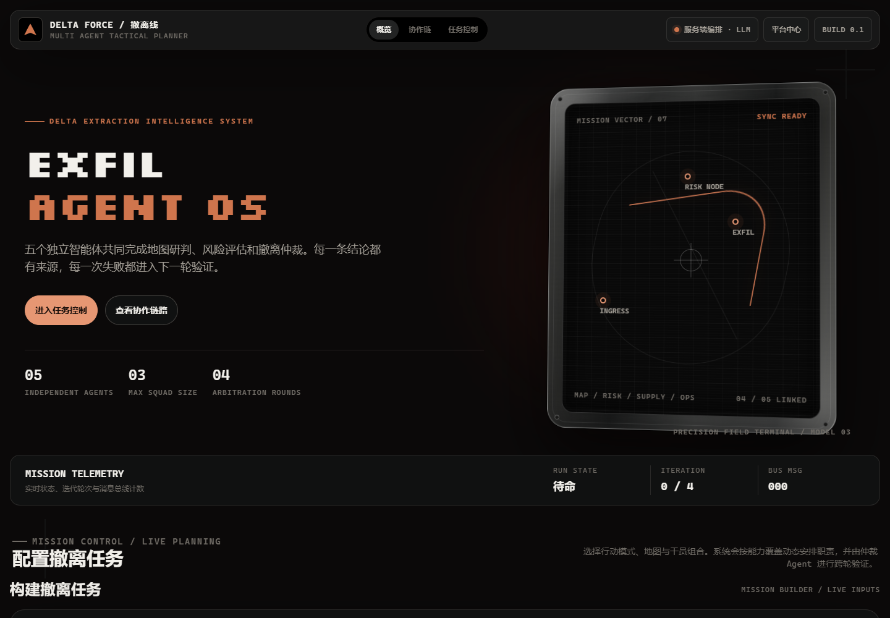
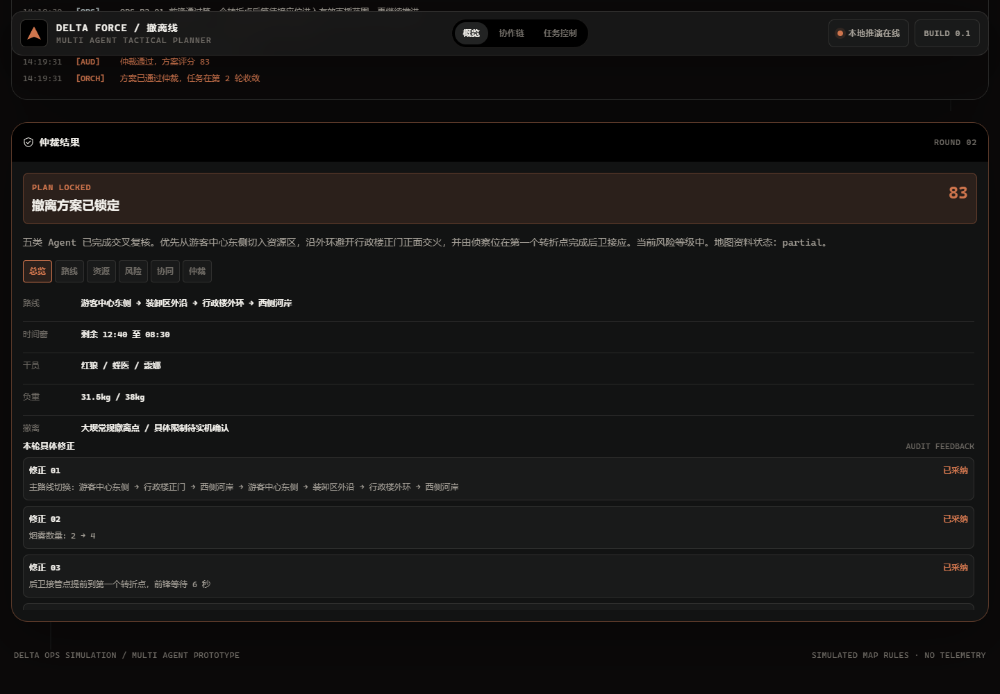
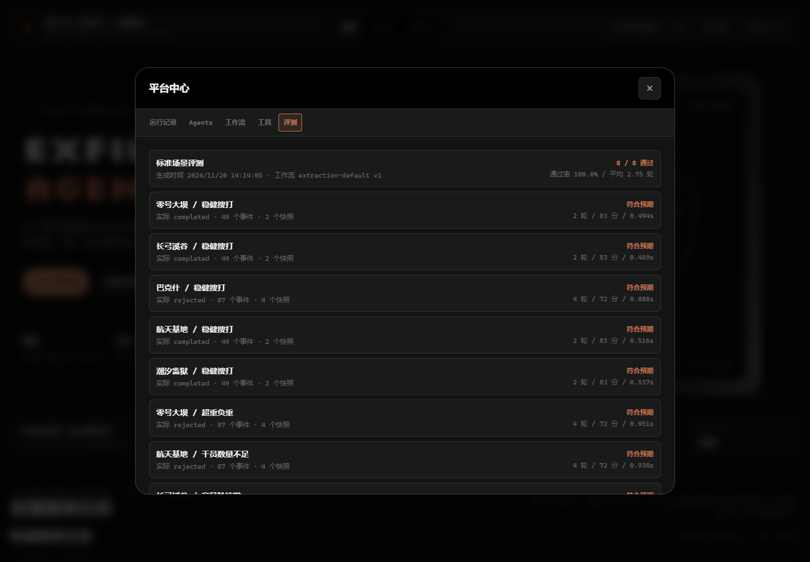

# AgentProof / 撤离线

面向撤离任务的多 Agent 协同规划原型。系统将地图事实、风险判断、物资约束、干员协同和最终审核拆成五个独立 Agent，并通过可解释调度、事件持久化和快照恢复形成完整的证据链。

## 核心能力

- 五类独立 Agent：地图情报、风险评估、物资规划、干员协同、校验复盘。
- 地图事实先行，风险、物资和干员三路并行草稿，交换结论后进行二次修正。
- 校验失败后生成具体修正指令，最多执行四轮，硬约束不会被模型文本绕过。
- FastAPI REST API 与 SSE 实时事件流。
- SQLite 保存运行、事件、快照、Agent 版本和工作流版本。
- 支持轮次差异、失败快照恢复和不可变审计分支。
- Tool Registry 与 stdio MCP 服务共用同一份工具定义。
- 可选 OpenAI 兼容模型；无密钥或调用失败时回退到确定性规则。

## 界面

桌面端首页：



最终仲裁结果：



场景评测：



## 快速启动

```powershell
cd backend
python -m venv .venv
.\.venv\Scripts\python.exe -m pip install -r requirements.txt
.\start.ps1
```

打开 <http://127.0.0.1:8000>。

也可以从仓库根目录运行：

```powershell
docker compose up --build
```

## 模型配置

将 `backend/.env.example` 复制为 `backend/.env`，按需配置：

```env
LLM_API_KEY=your-api-key
LLM_API_BASE=https://api.deepseek.com/v1
LLM_MODEL=deepseek-chat
LLM_FALLBACK_TO_MOCK=true
```

不配置模型密钥时，系统仍可使用本地规则完成全部演示。浏览器不会接触密钥。

## 工作流

```text
任务输入
  -> 地图情报 Agent
  -> 风险 / 物资 / 干员并行草稿
  -> 三路结论交换与二次修正
  -> 校验复盘 Agent
  -> 通过则锁定方案
  -> 失败则广播修正指令并进入下一轮
```

Agent 版本、能力标签、工具权限和优先级来自注册表。调度器根据工作流角色、任务打法、能力和优先级选择版本，并将选择理由写入运行事件。

## 主要接口

- `GET /api/health`
- `GET /api/maps`
- `GET /api/operators`
- `GET /api/agents`
- `GET /api/workflows`
- `GET /api/tools`
- `POST /api/runs`
- `GET /api/runs`
- `GET /api/runs/{run_id}`
- `GET /api/runs/{run_id}/event-log`
- `GET /api/runs/{run_id}/snapshots`
- `GET /api/runs/{run_id}/diff`
- `POST /api/runs/{run_id}/snapshots/{snapshot_id}/restore`
- `GET /api/runs/{run_id}/events`

完整示例见 `docs/API_EXAMPLES.md`。

## 测试与评测

运行自动化测试：

```powershell
cd backend
.\run-tests.ps1
```

当前结果：`10 passed`。

运行八场景评测：

```powershell
cd backend
python scripts/evaluate.py
```

最新评测结果：

- 8/8 场景符合预期
- 通过率 100%
- 平均 2.75 轮
- 规则引擎平均耗时约 0.622 秒

详细报告见 `backend/reports/evaluation-latest.json`。

## 项目结构

```text
.
├─ delta-agent-console.html
├─ docker-compose.yml
├─ backend/
│  ├─ app/
│  │  ├─ agents/
│  │  ├─ data/
│  │  ├─ services/
│  │  ├─ tools/
│  │  ├─ main.py
│  │  └─ schemas.py
│  ├─ reports/
│  ├─ runtime/          # 首次启动时自动创建 runs.db
│  ├─ scripts/
│  ├─ tests/
│  ├─ mcp_server.py
│  ├─ requirements.txt
│  ├─ start.ps1
│  └─ run-tests.ps1
├─ docs/
│  ├─ AgentProof-方案书.md
│  ├─ AgentProof-方案书.pdf
│  ├─ ARCHITECTURE.md
│  ├─ API_EXAMPLES.md
│  ├─ COMPETITION_README.md
│  ├─ DEMO_SCRIPT.md
│  ├─ JUDGE_QA.md
│  └─ SUBMISSION_CHECKLIST.md
└─ output/pdf/AgentProof-方案书.pdf
```

## 人工智能使用边界

- **LLM**：在确定性事实骨架上补充结构化推理和自然语言说明，失败时回退到本地规则。
- **MCP**：通过 stdio JSON-RPC 暴露与后端共用的工具注册表。
- **RAG**：当前版本未使用向量检索或 RAG。地图与干员数据规模小且结构明确，直接通过数据模块和工具读取。

## 数据边界

当前地图、撤离条件、资源点和干员数据为竞赛演示配置，不代表游戏官方实时数据。正式部署前需要按比赛指定版本核对，并在修改后重新运行测试与评测。
