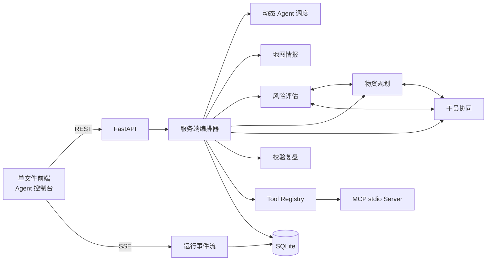
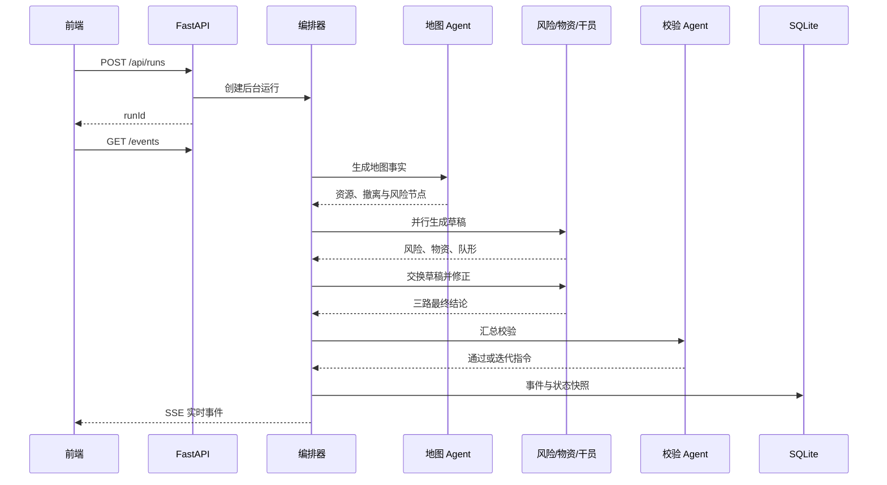

# 系统架构

## 总览



## 运行链路



## 数据表

- `runs`：运行状态、输入、轮次、分数、工作流和 Agent 版本清单
- `run_events`：Agent 状态、消息、工具调用、日志和轮次结果
- `snapshots`：每轮结构化状态，可用于回放、对比和恢复
- `agent_definitions`：Agent 身份
- `agent_versions`：提示词、能力、工具权限和优先级
- `workflows`：工作流身份
- `workflow_versions`：阶段定义、最大轮次和调度策略

## 动态调度

调度器根据以下信息选择 Agent 版本：

1. 工作流需要的角色
2. Agent 能力标签
3. 版本优先级
4. 当前任务打法
5. 工作流最大并行数

调度决策通过 `scheduler.decision` 事件写入运行记录，能够解释为什么选择某个版本。

## 工具与 MCP

核心工具：

- `map_lookup`
- `route_risk_probe`
- `loadout_validate`
- `extraction_check`
- `operator_catalog`
- `snapshot_query`

HTTP 调用：

```text
POST /api/tools/loadout_validate/invoke
```

MCP stdio：

```powershell
cd backend
.\.venv\Scripts\python.exe -m mcp_server
```

MCP 客户端配置示例：

```json
{
  "mcpServers": {
    "delta-exfil-tools": {
      "command": "C:/path/to/python.exe",
      "args": ["-m", "mcp_server"],
      "cwd": "C:/path/to/backend"
    }
  }
}
```

## 快照恢复

每次校验结束后保存完整状态：

```text
map + risk + supply + operator + audit
```

从失败轮次恢复时，系统创建一条新的运行记录，并从快照的下一轮继续，
原运行记录保持不变。这相当于不可变审计链上的分支，而不是覆盖旧数据。

## LLM 接入边界

浏览器永远不接触模型密钥。后端先生成确定性事实和响应骨架，再把事实提交给
OpenAI 兼容模型。模型返回 JSON 与骨架进行顶层合并，地图事实、消息编号和
客观校验结果仍然可追溯。
